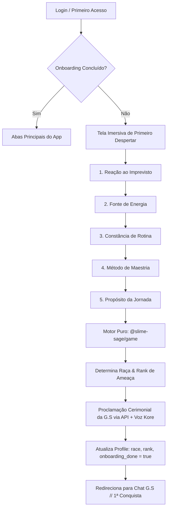

# Especificação Técnica — Fase 8: Onboarding do Despertar (Raça, Rank e G.S)

> **Status do Alinhamento (/grill-me):** Consolidado e validado com o usuário.  
> **Tema:** *Tensura* (Grande Sábio / Voz do Mundo) + *Solo Leveling* + Dark Fantasy Gilded RPG (`docs/design.png`).

---

## 1. Visão Geral e Arquitetura

O ritual de Onboarding do **Slime Sage** é acionado quando `profile.onboarding_done === false`. Em vez de liberar imediatamente as abas principais, o usuário é saudado pela Grande Sábio em uma **Tela Imersiva de Primeiro Despertar em tela cheia**, guiado por **5 perguntas pré-determinadas narradas pela voz oficial Kore** com efeito mágico *typewriter*.

Ao responder, o **Motor Puro de Jogo (`@slime-sage/game`)** calcula determinísticamente a **Raça (Espécie)** e o **Rank de Ameaça (Densidade de Magicules)** do usuário. Em seguida, a API da G.S (`apps/api`) proclama a revelação com síntese neural de voz antes de transicionar o usuário para o **Chat da G.S** para a criação do seu primeiro projeto denso (7 a 12 missões).

---

## 2. Taxonomia de Raças e Ranks (*Tensura*)

### 2.1. Espécies Despertadas (Raça)

A afinidade da personalidade do usuário nas 5 perguntas direciona para uma das linhagens de *Tensura*:

| Raça | Arquétipo de Personalidade | Atributo Primário | Glifo Rúnico |
| :--- | :--- | :--- | :--- |
| **Slime** | Mente analítica, resiliente, adaptabilidade ao caos e absorção contínua de conhecimento | `INT` (Inteligência) | `ᛋ ᛚ ᛁ ᛗ ᛖ` |
| **Kijin (Ogre Desperto)** | Espírito marcial, resiliência perante adversidades, honestidade e superação direta | `FOR` (Força) | `ᚲ ᛁ ᛃ ᛁ ᚾ` |
| **Draconiano (Dragonoid)** | Foco implacável, ambição de alto impacto, rigor de execução e disciplina de aço | `DIS` (Disciplina) | `ᛞ ᚱ ᚨ ᚲ ᛟ` |
| **Majin Arcano** | Criatividade fora da curva, imaginação mística, originalidade e inovação | `CRI` (Criatividade) | `ᛗ ᚨ ᛃ ᛁ ᚾ` |
| **Homem-Fera (Lycanthrope)** | Lealdade de matilha, liderança protetora, cooperação, instinto afiado e defesa dos seus pares | `SOC` (Social) | `ᚠ ᛖ ᚱ ᚨ` |

> [!NOTE]
> Conforme definido na sessão de alinhamento, o impacto da Raça é **cosmético e de lore**: enriquece os títulos do caçador, runas nórdicas na tela, insígnias visuais e diálogos da G.S, sem alterar os valores iniciais do ledger de XP puro.

### 2.2. Ranks de Ameaça (Densidade de Magicules)

Avaliado pela constância da rotina e estabilidade de hábitos do usuário:

1. **Classe Menor (Densidade Latente):** Rotina oscilante, iniciando a jornada de disciplina.
2. **Perigo (Hazard):** Hábitos em formação, foco moderado, pronta para desafios regulares.
3. **Calamidade (Calamity):** Disciplina consolidada, alta intensidade de execução e foco afiado.

---

## 3. Matriz das 5 Perguntas Pré-Determinadas

Cada pergunta possui 4 a 5 alternativas temáticas pontuando determinísticamente na matriz de Raça e Rank:

### Pergunta 1: Reação ao Imprevisto
> *Áudio G.S:* `"Aviso individual. Um evento inesperado colapsa seu planejamento. Qual é a sua resposta imediata?"`
- **A)** Analiso todas as variáveis e absorvo o novo cenário sem perder a calma. *(+INT / Slime)*
- **B)** Enfrento o obstáculo de frente com determinação inabalável. *(+FOR / Kijin)*
- **C)** Reorganizo a rotina com disciplina de ferro sem desvios. *(+DIS / Draconiano)*
- **D)** Improviso uma solução criativa e inusitada. *(+CRI / Majin)*
- **E)** Protejo e organizo meus aliados para enfrentarmos a crise como uma alcateia unida. *(+SOC / Homem-Fera)*

### Pergunta 2: Fonte Primária de Energia
> *Áudio G.S:* `"Pergunta do Sistema. O que sustenta sua chama interna nos dias mais exaustivos?"`
- **A)** A busca incessante por decifrar a verdade e aprender algo novo. *(+INT / Slime)*
- **B)** O prazer de superar a fraqueza e ficar mais forte a cada dia. *(+FOR / Kijin)*
- **C)** A satisfação do dever cumprido e da consistência inquebrável. *(+DIS / Draconiano)*
- **D)** A necessidade visceral de criar, construir e transformar ideias em realidade. *(+CRI / Majin)*
- **E)** A lealdade aos meus companheiros e a honra de proteger aqueles que confiam em mim. *(+SOC / Homem-Fera)*

### Pergunta 3: Relação com a Rotina Atual
> *Áudio G.S:* `"Avaliação de parâmetros vitais. Como você classifica a sua constância diária atual?"`
- **A)** Instável: inicio muitos objetivos, mas me perco no meio do caminho. *(Rank: Classe Menor)*
- **B)** Em transição: tenho momentos de grande foco, mas oscilo nos dias difíceis. *(Rank: Perigo / Hazard)*
- **C)** Inabalável: sigo minhas rotinas mesmo quando a motivação se esgota. *(Rank: Calamidade / Calamity)*

### Pergunta 4: Construção de Maestria
> *Áudio G.S:* `"Determinação de diretriz evolutiva. De que forma sua mente consolida novas habilidades?"`
- **A)** Mapeando teorias profundas e arquitetura dos conceitos antes de agir. *(+INT / Slime)*
- **B)** Execução repetitiva intensa até que a habilidade se torne instinto. *(+FOR / Kijin + DIS / Draconiano)*
- **C)** Misturando técnicas de áreas distintas de forma não convencional. *(+CRI / Majin)*
- **D)** Treinando ombro a ombro com companheiros, fortalecendo a mim e à matilha. *(+SOC / Homem-Fera)*

### Pergunta 5: Propósito Maior da Jornada
> *Áudio G.S:* `"Inquisição final da Grande Sábio. Diante do ápice de seu potencial, o que você busca alcançar?"`
- **A)** O conhecimento total e a compreensão dos mistérios do mundo. *(+INT / Slime)*
- **B)** Tornar-me inabalável, uma muralha capaz de proteger tudo o que prezo. *(+FOR / Kijin)*
- **C)** Soberania absoluta sobre meu próprio destino e legado imperecível. *(+DIS / Draconiano)*
- **D)** Deixar uma marca singular no cosmos através da minha criação. *(+CRI / Majin)*
- **E)** Proteger meu clã e erguer um território seguro onde minha alcateia seja temida e respeitada. *(+SOC / Homem-Fera)*

---

## 4. Plano de Implementação por Módulo

### 4.1. Pacote Compartilhado (`@slime-sage/shared`)
- Atualizar [`ProfileSchema`](file:///workspaces/Skill-Grinding/packages/shared/src/index.ts#L83-L96) adicionando:
  - `race: z.string().default("Slime")`
  - `rank_threat: z.string().default("Classe Menor")`
- Exportar constantes `TENSU_RACES`, `THREAT_RANKS` e `ONBOARDING_QUESTIONS`.

### 4.2. Motor de Jogo Puro (`@slime-sage/game`)
- Criar `packages/game/src/onboarding.ts`:
  - Função pura `calculateAwakening(answers: OnboardingAnswers): AwakeningResult`
  - Cobertura de testes unitários com Vitest em `onboarding.test.ts` (100% de cobertura).

### 4.3. Áudios Oficiais da G.S (`apps/pwa/public/audio/voice/`)
- Atualizar [`scripts/voice-config.json`](file:///workspaces/Skill-Grinding/scripts/voice-config.json) com as falas das 5 perguntas e da consagração.
- Gerar os clipes oficiais em MP3 via Gemini Kore voice (`onboarding-q1.mp3` até `onboarding-q5.mp3` e `onboarding-reveal.mp3`).

### 4.4. Interface PWA (`apps/pwa`)
- Criar `AwakeningScreen.tsx` com:
  - Tema Dark Fantasy Gilded RPG (`#040814`, `rounded-none`, `GildedCorners`, runas Elder Futhark reativas).
  - Digitação mágica *typewriter*.
  - Player de áudio da G.S com botão de replay.
  - Seletor de alternativas com cartelas góticas e losangos dourados.
  - Ritual de Revelação com círculo mágico esotérico concêntrico em SVG e proclamação da G.S.
  - Transição para o Chat da G.S ao concluir.
- Adicionar no [`DevPanel.tsx`](file:///workspaces/Skill-Grinding/apps/pwa/src/components/DevPanel.tsx) a ação **"Resetar Onboarding (Re-despertar)"**.
- Exibir a Raça e o Rank de Ameaça no banner do Caçador em [`HomeView.tsx`](file:///workspaces/Skill-Grinding/apps/pwa/src/components/views/HomeView.tsx) e [`StatusView.tsx`](file:///workspaces/Skill-Grinding/apps/pwa/src/components/views/StatusView.tsx).

---

## 5. Roteiro de Testes Automáticos e Manuais

1. **Testes Unitários:**
   - `onboarding.test.ts`: testar todas as combinações de respostas, desempate determinístico e validação de schema.
   - `ProfileSchema.test.ts`: validar migração e valores default para `race` e `rank_threat`.
2. **Testes de Componente:**
   - Renderização da tela de Despertar quando `profile.onboarding_done === false`.
   - Navegação passo a passo entre as 5 perguntas.
   - Disparo correto do áudio oficial para cada pergunta.
   - Chamada da API para síntese do decreto final e atualização do perfil.
3. **E2E Playwright:**
   - Criar usuário novo → responder 5 perguntas → verificar consagração de Raça/Rank → validar abertura do Chat G.S → verificar exibição da Raça na Home.
